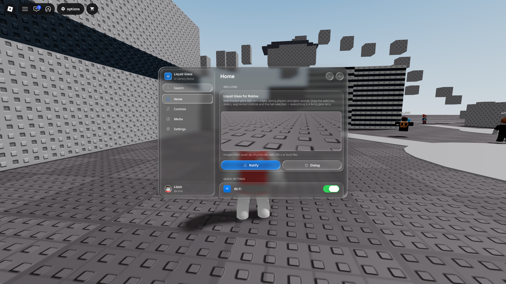

# LiquidGlass

**Библиотека интерфейса в стиле iOS 26 «Liquid Glass» для Roblox-скриптов.**

<p align="center">
  
</p>

---

## Возможности

- **Настоящее стекло** — каждая поверхность выглядит как линза из матового стекла: размывает мир позади и преломляет свет по краям.
- **Живые контролы** — тогглы, слайдеры, сегменты и вкладки превращаются в прозрачную стеклянную линзу, пока их держат, и пружинят обратно.
- **Полный набор элементов**: Toggle, Slider, Dropdown (одиночный / мульти / с поиском), Input, Keybind, ColorPicker (с прозрачностью), Segmented, Stepper, Progress, Button, Label, Paragraph, Code, Image, Custom.
- **Уведомления, диалоги, тултипы, меню**.
- **Готовая вкладка Settings** + сохранение/загрузка конфигов.
- **165 встроенных иконок**, ассеты, аватарки, веб-URL и локальные файлы.
- **Темы** Dark / Light, акцент, масштаб, blur, звуки.

---

## Установка

```lua
local LiquidGlass = loadstring(game:HttpGet(
    "https://raw.githubusercontent.com/Be1for/lua/refs/heads/main/LiquidGlass/LiquidGlass.lua"
))()
```

Локальная сборка (если есть файл):

```lua
local LiquidGlass = loadstring(readfile("LiquidGlass/LiquidGlass.lua"))()
```

---

## Быстрый старт

```lua
local LiquidGlass = loadstring(game:HttpGet(
    "https://raw.githubusercontent.com/Be1for/lua/refs/heads/main/LiquidGlass/LiquidGlass.lua"
))()

local Window = LiquidGlass:CreateWindow({
    Title = "My Script",
    Subtitle = "v1.0",
    Icon = "layers",
    Size = Vector2.new(720, 500),
    ToggleKey = Enum.KeyCode.RightControl,
})

local Tab = Window:AddTab({ Title = "Main", Icon = "home" })
local Section = Tab:AddSection("Settings")

Section:AddToggle({
    Title = "Enabled",
    Default = true,
    Flag = "enabled",
    Callback = function(value)
        print("Toggle:", value)
    end,
})
```

Клавиша по умолчанию для скрытия/показа окна — **Right Ctrl**.

---

## Окно (Window)

```lua
local Window = LiquidGlass:CreateWindow({
    Title = "Liquid Glass",          -- заголовок
    Subtitle = "UI Library Demo",    -- подзаголовок
    Icon = "layers",                 -- иконка (имя или id)
    Size = Vector2.new(720, 500),    -- размер
    ToggleKey = Enum.KeyCode.RightControl,
    Theme = "Dark",                  -- "Dark" | "Light"
    -- ConfigurationSaving = { Enabled = true, FolderName = "MyScript", FileName = "config" },
})
```

Полезные методы:

| Метод | Описание |
|-------|----------|
| `Window:AddTab({ Title, Icon })` | Добавить вкладку |
| `Window:SelectTab(tab)` | Переключить вкладку |
| `Window:SetTitle(text)` / `SetSubtitle(text)` | Изменить заголовки |
| `Window:SetSize(Vector2)` | Изменить размер |
| `Window:SetVisible(bool)` / `Toggle()` | Показать / скрыть |
| `Window:Minimize()` / `Restore()` | Свернуть / развернуть |
| `Window:Center()` | Центрировать |
| `Window:AddSettingsTab()` | Готовая вкладка настроек |
| `Window:Destroy()` | Уничтожить окно |

---

## Вкладки и секции

```lua
local Tab = Window:AddTab({ Title = "Home", Icon = "home" })
local Section = Tab:AddSection("Welcome")          -- с заголовком
local Section2 = Tab:AddSection({})               -- без заголовка
```

---

## Элементы

Все элементы принимают таблицу опций. Общие поля:

| Поле | Тип | Описание |
|------|-----|----------|
| `Title` | string | Заголовок |
| `Description` | string | Подзаголовок / описание |
| `Icon` | string | Иконка (имя из набора или asset) |
| `IconColor` | Color3 / string | Цвет иконки |
| `Flag` | string | Ключ для конфигов |
| `Default` / `Value` | any | Начальное значение |
| `Callback` | function | Вызывается при изменении |
| `Disabled` | bool | Заблокировать |
| `Tooltip` | string | Подсказка при наведении |
| `NoSave` | bool | Не сохранять в конфиг |

Методы элемента:

- `el:Set(value, silent?)` — установить значение
- `el:GetValue()` / `el.Value` — получить значение
- `el:SetVisible(bool)`, `el:SetDisabled(bool)`, `el:SetTitle()`, `el:SetDescription()`
- `el:OnChanged(fn)` — дополнительный колбэк
- `el:Destroy()`

---

### Toggle (переключатель)

```lua
Section:AddToggle({
    Title = "Wi-Fi",
    Description = "Включить беспроводную сеть",
    Icon = "wifi",
    IconColor = Color3.fromRGB(10, 132, 255),
    Default = true,
    Flag = "wifi",
    Callback = function(value)
        print("Wi-Fi:", value)
    end,
})
```

---

### Slider (ползунок)

```lua
Section:AddSlider({
    Title = "Walk speed",
    Description = "Скорость ходьбы",
    Min = 16,
    Max = 120,
    Default = 16,
    Step = 1,                    -- шаг
    Suffix = "",                 -- суффикс (например "°" или "%")
    Flag = "speed",
    Callback = function(value)   -- вызывается при движении
        -- ...
    end,
    Released = function(value)   -- когда отпустили
        -- ...
    end,
})
```

---

### Stepper (шаговый счётчик)

```lua
Section:AddStepper({
    Title = "Jump count",
    Min = 0,
    Max = 10,
    Default = 2,
    Flag = "jumps",
    Callback = function(value)
        print(value)
    end,
})
```

---

### Progress (индикатор прогресса)

```lua
local progress = Section:AddProgress({
    Title = "Download",
    Default = 0.62,              -- от 0 до 1
})

-- позже можно обновлять
progress:Set(0.85)
```

---

### Segmented (сегментированный контроль)

```lua
Section:AddSegmented({
    Title = "Appearance",
    Options = { "Dark", "Light" },
    Default = "Dark",
    Flag = "theme",
    Callback = function(value)
        LiquidGlass:SetTheme(value)
    end,
})

-- без заголовка (только сегменты)
Section:AddSegmented({
    Options = { "Low", "Medium", "High", "Ultra" },
    Default = "High",
    Flag = "quality",
})
```

---

### Dropdown (выпадающий список)

```lua
-- одиночный выбор
Section:AddDropdown({
    Title = "Weapon",
    Options = { "Sword", "Bow", "Staff", "Hammer" },
    Default = "Sword",
    Flag = "weapon",
    Icon = "target",
    Callback = function(value)
        print("Selected:", value)
    end,
})

-- мультивыбор
Section:AddDropdown({
    Title = "Targets",
    Description = "Можно выбрать несколько",
    Options = { "Players", "NPCs", "Bosses", "Chests" },
    Multi = true,
    Default = { "Players", "Bosses" },
    Flag = "targets",
    Callback = function(values)   -- table
        print(table.concat(values, ", "))
    end,
})

-- с поиском
Section:AddDropdown({
    Title = "Teleport to player",
    Options = playersList,
    Searchable = true,
    Icon = "user",
})
```

---

### Input (текстовое поле)

```lua
Section:AddInput({
    Title = "Display name",
    Placeholder = "Введите имя",
    Default = "",
    Flag = "name",
    Callback = function(text)
        LiquidGlass:Notify({ Title = "Name set", Content = text, Duration = 2 })
    end,
})

-- многострочный
Section:AddInput({
    Title = "Notes",
    Multiline = true,
    Placeholder = "Многострочный текст…",
})
```

---

### Keybind (привязка клавиши)

```lua
Section:AddKeybind({
    Title = "Sprint",
    Default = Enum.KeyCode.LeftShift,
    Mode = "Hold",               -- "Toggle" | "Hold" | "Always"
    Flag = "sprintKey",
    Callback = function(active)
        -- active = true/false в режиме Hold/Toggle
    end,
    ChangedCallback = function(key)
        print("New key:", key)
    end,
})

Section:AddKeybind({
    Title = "Fly",
    Default = "F",               -- можно строкой
    Flag = "flyKey",
    Callback = function(on)
        LiquidGlass:Notify({
            Title = on and "Fly on" or "Fly off",
            Type = on and "Success" or "Info",
            Duration = 1.5,
        })
    end,
})
```

---

### ColorPicker (выбор цвета)

```lua
Section:AddColorPicker({
    Title = "ESP color",
    Default = Color3.fromRGB(255, 45, 85),
    Flag = "espColor",
    Callback = function(color)
        print(color)
    end,
})

-- с прозрачностью
Section:AddColorPicker({
    Title = "Glow",
    Description = "С альфа-каналом",
    Default = Color3.fromRGB(94, 92, 230),
    Transparency = 0.3,
    Flag = "glow",
    Callback = function(color, transparency)
        -- ...
    end,
})
```

---

### Button / Buttons

```lua
-- одиночная кнопка
Section:AddButton({
    Title = "Rejoin server",
    Description = "Перезайти на сервер",
    Icon = "refresh",
    IconColor = Color3.fromRGB(142, 142, 147),
    Callback = function()
        -- ...
    end,
})

-- стили
Section:AddButton({
    Title = "Primary action",
    Style = "Primary",           -- Primary | Glass | Destructive
    Icon = "bolt",
})

Section:AddButton({
    Title = "Reset everything",
    Destructive = true,          -- красная опасная кнопка
    Icon = "trash",
    Tooltip = "Спросит подтверждение",
    Callback = function()
        Window:Dialog({
            Title = "Reset everything?",
            Content = "Это действие нельзя отменить.",
            Icon = "warning",
            IconColor = "Danger",
            Buttons = {
                { Title = "Cancel", Style = "Cancel" },
                { Title = "Reset", Style = "Destructive", Callback = function() end },
            },
        })
    end,
})

-- несколько кнопок в ряд
Section:AddButtons({
    { Title = "Save", Style = "Primary", Icon = "save", Callback = function() end },
    { Title = "Load", Icon = "download", Callback = function() end },
    { Title = "Delete", Style = "Destructive", Icon = "trash", Callback = function() end },
})
```

---

### Paragraph (абзац)

```lua
Section:AddParagraph({
    Title = "Liquid Glass for Roblox",
    Content = "Real frosted glass with lens edges, spring physics and glass sounds.",
})
```

---

### Label (метка)

```lua
Section:AddLabel("Просто текстовая строка.")
```

---

### Image (изображение)

```lua
Section:AddImage({
    Image = "rbxthumb://type=GameIcon&id=" .. game.GameId .. "&w=512&h=512",
    Height = 150,
    Caption = "Иконка игры",
    ScaleType = "Fit",           -- Fit | Crop | Stretch
})

-- аватар игрока
Section:AddImage({
    Image = LiquidGlass:Avatar(game.Players.LocalPlayer.UserId, "AvatarBust"),
    Height = 180,
    Caption = "Ваш аватар",
})

-- встроенная иконка
Section:AddImage({
    Image = "music",
    Height = 90,
    Caption = "Встроенные иконки тоже масштабируются",
})
```

---

### Code (блок кода)

```lua
Section:AddCode({
    Title = "Load this library",
    Code = 'local LiquidGlass = loadstring(game:HttpGet("https://…/LiquidGlass.lua"))()',
})
```

---

### Custom (свой контент)

```lua
Section:AddCustom({
    Title = "Anything you want",
    Height = 60,
    Build = function(frame, element, library)
        local bar = Instance.new("Frame")
        bar.Size = UDim2.new(1, 0, 0, 44)
        bar.BackgroundColor3 = Color3.fromRGB(10, 132, 255)
        bar.BackgroundTransparency = 0.2
        Instance.new("UICorner", bar).CornerRadius = UDim.new(0, 12)
        bar.Parent = frame
    end,
})
```

---

### Divider / Spacer

```lua
Section:AddDivider()
Section:AddSpacer(20)   -- высота в пикселях
```

---

## Уведомления (Notify)

```lua
LiquidGlass:Notify({
    Title = "Hello!",
    Content = "Это уведомление Liquid Glass. Наведите, чтобы поставить на паузу, свайпните вправо, чтобы закрыть.",
    Duration = 6,                -- секунды (0 = бесконечно)
    Type = "Info",               -- Info | Success | Warning | Error
    -- Icon / Image = "bell",
    Actions = {
        { Title = "OK", Style = "Primary", Callback = function() end },
    },
    OnClick = function() end,
    OnClose = function() end,
})
```

Позиция уведомлений:

```lua
LiquidGlass.NotifyPosition = "TopRight"   -- TopLeft | TopCenter | BottomRight | BottomLeft
```

---

## Диалоги (Dialog)

```lua
Window:Dialog({
    Title = "Liquid Glass",
    Content = "Диалоги парят над окном на отдельном листе стекла.",
    Icon = "sparkles",
    -- IconColor = "Accent",
    -- Input = { Placeholder = "Введите текст", Default = "" },
    Buttons = {
        { Title = "Cancel", Style = "Cancel" },
        { Title = "Continue", Style = "Primary", Callback = function(inputText)
            -- если вернуть false — диалог не закроется
            LiquidGlass:Notify({ Title = "Continued", Type = "Success", Duration = 3 })
        end },
    },
    CloseOnShade = true,         -- закрывать при клике по затемнению
})
```

---

## Темы и внешний вид

```lua
LiquidGlass:SetTheme("Dark")     -- или "Light"
LiquidGlass:SetAccent(Color3.fromRGB(10, 132, 255))
LiquidGlass:SetBlur(true)
LiquidGlass:SetScale(1.0)        -- 0.6 … 1.4
LiquidGlass.Settings.Sounds = true
LiquidGlass.Settings.Volume = 1
```

Готовая вкладка настроек (тема, акцент, blur, масштаб, звуки, клавиша, конфиги):

```lua
Window:AddSettingsTab()
-- или
Window:AddSettings()
```

---

## Конфиги

Элементы с `Flag` автоматически могут сохраняться.

```lua
LiquidGlass:SetConfigFolder("MyScript")   -- папка в workspace эксплойтера

LiquidGlass:SaveConfig("default")
LiquidGlass:LoadConfig("default")
LiquidGlass:DeleteConfig("default")
print(LiquidGlass:ListConfigs())          -- список имён

LiquidGlass:SetAutoload("default")        -- грузить при старте
LiquidGlass:LoadAutoload()
```

Или через `ConfigurationSaving` при создании окна (стиль Rayfield):

```lua
local Window = LiquidGlass:CreateWindow({
    Title = "My Script",
    ConfigurationSaving = {
        Enabled = true,
        FolderName = "MyScript",
        FileName = "config",
    },
})
-- после создания всех элементов:
LiquidGlass:LoadConfiguration()
```

---

## Иконки и изображения

- **Встроенные иконки** — просто имя: `"home"`, `"settings"`, `"bell"`, `"wifi"`, `"trash"` и т.д. (165 штук).
- **Asset id**: `"rbxassetid://123456789"`
- **Аватар**: `LiquidGlass:Avatar(userId, "AvatarBust" | "AvatarHeadShot" | ...)`
- **Веб-URL** и локальные файлы (если эксплойтер поддерживает).

```lua
print(LiquidGlass:GetIcon("home"))   -- получить id иконки
```

---

## Уничтожение

```lua
LiquidGlass:Destroy()     -- или LiquidGlass:Unload()
-- все окна, уведомления, соединения и GUI удаляются
```

---

## Полный пример

Смотрите файл `LiquidGlass_Demo.lua` — в нём показаны почти все элементы, уведомления и диалоги.

```lua
local LiquidGlass = loadstring(game:HttpGet(
    "https://raw.githubusercontent.com/Be1for/lua/refs/heads/main/LiquidGlass/LiquidGlass.lua"
))()

local Window = LiquidGlass:CreateWindow({
    Title = "Liquid Glass",
    Subtitle = "UI Library Demo",
    Icon = "layers",
    Size = Vector2.new(720, 500),
})

local Home = Window:AddTab({ Title = "Home", Icon = "home" })
local Hero = Home:AddSection("Welcome")

Hero:AddParagraph({
    Title = "Liquid Glass for Roblox",
    Content = "Real frosted glass with lens edges, spring physics and glass sounds.",
})

Hero:AddButtons({
    {
        Title = "Notify",
        Style = "Primary",
        Icon = "bell",
        Callback = function()
            LiquidGlass:Notify({
                Title = "Hello!",
                Content = "Это уведомление Liquid Glass.",
                Duration = 6,
            })
        end,
    },
    {
        Title = "Dialog",
        Icon = "info",
        Callback = function()
            Window:Dialog({
                Title = "Liquid Glass",
                Content = "Диалоги парят над окном.",
                Icon = "sparkles",
                Buttons = {
                    { Title = "Cancel", Style = "Cancel" },
                    { Title = "Continue", Style = "Primary" },
                },
            })
        end,
    },
})

Window:AddSettingsTab()

LiquidGlass:Notify({
    Title = "Liquid Glass loaded",
    Content = "Нажмите Right Ctrl, чтобы скрыть/показать окно.",
    Type = "Success",
    Duration = 5,
})
```

---

## Лицензия и кредиты

Сделано в стиле iOS 26 Liquid Glass.  
Используйте свободно в своих скриптах.

<p align="center">
  
</p>


туторчик писал claude sonnet 5 так как я лентяй
