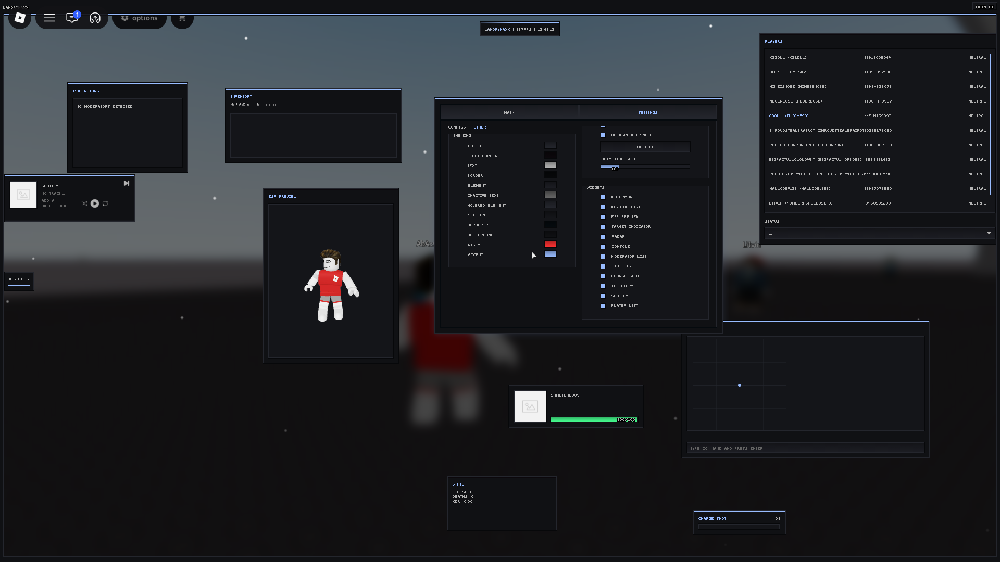

# 🖤 Landryhaxx UI — NH UI Library



> A clean, feature-rich Roblox exploit UI library built on top of **NH UI**.  
> Supports toggles, sliders, dropdowns, keybinds, colorpickers, textboxes, buttons, and many built-in widgets.

---

## 📦 Installation

```lua
local Library = loadstring(game:HttpGet("https://raw.githubusercontent.com/Be1for/lua/refs/heads/main/Nhack%20Ui/Nhack_Ui.lua"))()
```

---

## 🚀 Quick Start

```lua
local Library = loadstring(game:HttpGet("https://raw.githubusercontent.com/Be1for/lua/refs/heads/main/Nhack%20Ui/Nhack_Ui.lua"))()

_G.Library = Library
getgenv().Library = Library

local Window = Library:Window({
    Title = "Landryhaxx",
    ButtonName = "Main UI"
})

local Page    = Window:Page({ Name = "Main" })
local SubPage = Page:SubPage({ Name = "Combat" })
local Section = SubPage:Section({ Name = "Aimbot", Side = 1 })

Window:CreateSettingsPage()
```

---

## 🪟 Window

Creates the main UI window.

```lua
local Window = Library:Window({
    Title      = "Landryhaxx",  -- Title shown at the top of the window
    ButtonName = "Main UI"      -- Name on the open/close button
})
```

| Parameter    | Type   | Description                        |
|--------------|--------|------------------------------------|
| `Title`      | string | Title text at the top of the UI    |
| `ButtonName` | string | Label for the main toggle button   |

---

## 📄 Pages & SubPages

```lua
local Page    = Window:Page({ Name = "Main" })
local SubPage = Page:SubPage({ Name = "Combat" })
```

- **Page** — a top-level tab in the window.
- **SubPage** — a nested tab inside a Page.

---

## 📋 Sections

Sections group elements visually. `Side` controls left (`1`) or right (`2`) column.

```lua
local LeftSection  = SubPage:Section({ Name = "Aimbot",  Side = 1 })
local RightSection = SubPage:Section({ Name = "Visuals", Side = 2 })
```

---

## 🔘 Toggle

A simple on/off switch.

```lua
Section:Toggle({
    Name     = "Enable Aimbot",  -- Display name
    Flag     = "AimbotEnabled",  -- Unique identifier (used for saving configs)
    Default  = false,            -- Default state (true = on, false = off)
    Callback = function(Value)
        -- Value is true or false
        print("Aimbot:", Value)
    end
})
```

| Parameter  | Type     | Description                     |
|------------|----------|---------------------------------|
| `Name`     | string   | Label shown next to the toggle  |
| `Flag`     | string   | Unique key for config saving    |
| `Default`  | boolean  | Initial state                   |
| `Callback` | function | Called with `true`/`false`      |

---

## 🎚️ Slider

A draggable slider for numeric values.

```lua
Section:Slider({
    Name     = "FOV",
    Flag     = "AimbotFOV",
    Default  = 90,       -- Starting value
    Min      = 1,        -- Minimum value
    Max      = 360,      -- Maximum value
    Decimals = 0,        -- Decimal places (0 = integer)
    Suffix   = "°",      -- Unit label shown after value (optional)
    Callback = function(Value)
        print("FOV:", Value)
    end
})
```

| Parameter  | Type     | Description                              |
|------------|----------|------------------------------------------|
| `Name`     | string   | Label shown above the slider             |
| `Flag`     | string   | Unique key for config saving             |
| `Default`  | number   | Starting value                           |
| `Min`      | number   | Minimum allowed value                    |
| `Max`      | number   | Maximum allowed value                    |
| `Decimals` | number   | Decimal precision (`0` = whole numbers)  |
| `Suffix`   | string   | Unit text shown after value (optional)   |
| `Callback` | function | Called with the new numeric value        |

---

## 🔽 Dropdown

A list of selectable options.

```lua
Section:Dropdown({
    Name     = "Aim Part",
    Flag     = "AimPart",
    Items    = { "Head", "Torso", "HumanoidRootPart" },
    Default  = "Head",   -- or a table for Multi
    Multi    = false,    -- true = multiple selections allowed
    Callback = function(Value)
        print("Selected:", Value)
    end
})
```

| Parameter  | Type            | Description                                     |
|------------|-----------------|-------------------------------------------------|
| `Name`     | string          | Label shown above the dropdown                  |
| `Flag`     | string          | Unique key for config saving                    |
| `Items`    | table           | List of string options                          |
| `Default`  | string/table    | Default selected value(s)                       |
| `Multi`    | boolean         | Allow selecting multiple items                  |
| `Callback` | function        | Called with selected value or table of values   |

---

## 🔑 Keybind

Lets the user bind a key.

```lua
Section:Label({ Name = "Toggle Key" }):Keybind({
    Flag     = "AimbotKey",
    Mode     = "Toggle",   -- "Toggle" or "Hold"
    Default  = Enum.KeyCode.E,
    Callback = function(Value)
        print("Key changed to:", Value)
    end
})
```

| Parameter  | Type        | Description                           |
|------------|-------------|---------------------------------------|
| `Flag`     | string      | Unique key for config saving          |
| `Mode`     | string      | `"Toggle"` or `"Hold"`               |
| `Default`  | KeyCode     | Default key binding                   |
| `Callback` | function    | Called when key changes               |

---

## 🎨 Colorpicker

A full RGB/HSV color picker.

```lua
Section:Label({ Name = "ESP Color" }):Colorpicker({
    Flag     = "ESPColor",
    Default  = Color3.fromRGB(255, 0, 0),
    Callback = function(Value)
        -- Value is a Color3
        print("Color:", Value)
    end
})
```

| Parameter  | Type     | Description                          |
|------------|----------|--------------------------------------|
| `Flag`     | string   | Unique key for config saving         |
| `Default`  | Color3   | Default color                        |
| `Callback` | function | Called with the new `Color3` value   |

---

## ✏️ Textbox

A text input field.

```lua
Section:Textbox({
    Name        = "Config Name",
    Flag        = "ConfigName",
    Placeholder = "Enter name...",
    Callback    = function(Value)
        print("Input:", Value)
    end
})
```

| Parameter     | Type     | Description                              |
|---------------|----------|------------------------------------------|
| `Name`        | string   | Label shown above the textbox            |
| `Flag`        | string   | Unique key                               |
| `Placeholder` | string   | Grey hint text when empty                |
| `Callback`    | function | Called with the string value on submit   |

---

## 🖱️ Button

A clickable button.

```lua
Section:Button({
    Name     = "Execute",
    Callback = function()
        print("Button clicked!")
    end
})
```

| Parameter  | Type     | Description                    |
|------------|----------|--------------------------------|
| `Name`     | string   | Label on the button            |
| `Callback` | function | Called when clicked            |

---

## 🏷️ Label

A static text label. Can also be a parent for Keybind or Colorpicker.

```lua
Section:Label({ Name = "Section Header" })
```

---

## 🔔 Notification

Shows a temporary pop-up notification.

```lua
Library:Notification(
    "Landryhaxx Loaded",       -- Message text
    3,                          -- Duration in seconds
    Library.Theme["Accent"]    -- Color3 accent color
)
```

---

## 🌊 Watermark

A draggable overlay showing dynamic info (FPS, time, etc.).

```lua
local Watermark = Library:Watermark({ Name = "Landryhaxx" })

Watermark:SetDynamicTextProvider(function(Fps)
    return string.format("Landryhaxx | %dfps | %s", Fps, os.date("%X"))
end)

Watermark:SetVisibility(true)   -- show
Watermark:SetVisibility(false)  -- hide
```

---

## ⌨️ Keybind List Widget

Displays all active keybinds in a floating panel.

```lua
local KeybindList = Library:KeybindList({ Name = "Keybinds" })
KeybindList:SetVisibility(true)
```

---

## 👁️ ESP Preview Widget

A floating preview of your ESP settings.

```lua
local ESPPreview = Library:ESPPreview({ Name = "ESP Preview" })
ESPPreview:SetVisibility(false)
```

---

## 🎯 Target Indicator

Shows a directional indicator pointing at your current target.

```lua
local TargetIndicator = Library:TargetIndicator()
TargetIndicator:SetVisibility(false)
```

---

## 📡 Radar Widget

A minimap-style radar showing nearby players.

```lua
local Radar = Library:RadarWidget({ Name = "Radar" })
Radar:SetVisibility(false)
```

---

## 🖥️ Console Logger

A floating console for custom debug output.

```lua
local Logger = Library:ConsoleLogger({
    Name     = "Console",
    Callback = function(Text, Log)
        Log:AddOutput(Text)
    end
})
Logger:SetVisibility(false)
```

---

## 🛡️ Moderator List

Displays a list of moderators in-game.

```lua
local ModeratorList = Library:ModeratorList({ Name = "Moderators" })
ModeratorList:SetVisibility(false)
```

---

## 📊 Stat List Widget

Shows custom stat lines (kills, deaths, KDR, etc.).

```lua
local StatList = Library:StatListWidget({ Name = "Stats" })

StatList:SetLines({
    "Kills: 0",
    "Deaths: 0",
    "KDR: 0.00"
})
StatList:SetVisibility(false)
```

---

## ⚡ Charge Shot Widget

Visual indicator for a charge-shot mechanic.

```lua
local ChargeShot = Library:ChargeShotWidget({ Name = "Charge Shot" })
ChargeShot:SetVisibility(false)
```

---

## 🎒 Inventory Viewer

Displays the local player's inventory items.

```lua
local Inventory = Library:InventoryViewer({ Name = "Inventory" })
Inventory:SetVisibility(false)
```

---

## 🎵 Spotify Player

A floating Spotify-style music player widget.

```lua
local Spotify = Library:SpotifyPlayer()
Spotify:SetVisibility(false)
```

---

## 👥 Player List

Shows a list of all players currently in the server.

```lua
local Playerlist = Library:Playerlist({ Name = "Players" })
Playerlist:SetVisibility(false)
```

---

## ⚙️ Settings Widget Registration

Register any widget as a toggle in the built-in Settings page.

```lua
Library:RegisterSettingsWidget({
    Name     = "Watermark",
    Default  = true,            -- Visible by default?
    Callback = function(Value)
        Watermark:SetVisibility(Value)
    end
})
```

---

## 💾 Config System

Built into the Settings page automatically via `Window:CreateSettingsPage()`.

```lua
Window:CreateSettingsPage()
```

This adds:
- **Configs** — create, load, save, delete JSON config files
- **Theming** — live color customization for every UI element
- **Settings** — UI keybind, background blur/snow, animation speed, unload button
- **Widgets** — toggle visibility of all registered widgets

---

## 🎨 Theme

Access theme colors via `Library.Theme`:

```lua
Library.Theme["Accent"]      -- Main accent color
Library.Theme["Background"]  -- Background color
-- etc.
```

Change a theme color at runtime:

```lua
Library:ChangeTheme("Accent", Color3.fromRGB(100, 200, 255))
```

---

## 🗑️ Unload

Cleanly destroys the UI and all connections:

```lua
Library:Exit()
```

---

## 📝 Full Example Script

```lua
local Library = loadstring(game:HttpGet("https://raw.githubusercontent.com/Be1for/lua/refs/heads/main/Nhack%20Ui/Nhack_Ui.lua"))()

_G.Library = Library
getgenv().Library = Library

local Watermark = Library:Watermark({ Name = "Landryhaxx" })
Watermark:SetDynamicTextProvider(function(Fps)
    return string.format("Landryhaxx | %dfps | %s", Fps, os.date("%X"))
end)

local KeybindList = Library:KeybindList({ Name = "Keybinds" })

local Window = Library:Window({
    Title      = "Landryhaxx",
    ButtonName = "Main UI"
})

Library:RegisterSettingsWidget({
    Name = "Watermark", Default = true,
    Callback = function(v) Watermark:SetVisibility(v) end
})
Library:RegisterSettingsWidget({
    Name = "Keybind List", Default = true,
    Callback = function(v) KeybindList:SetVisibility(v) end
})

local Page    = Window:Page({ Name = "Main" })
local SubPage = Page:SubPage({ Name = "Combat" })

local Left  = SubPage:Section({ Name = "Aimbot",  Side = 1 })
local Right = SubPage:Section({ Name = "Visuals", Side = 2 })

Left:Toggle({
    Name = "Enable Aimbot", Flag = "AimbotEnabled", Default = false,
    Callback = function(Value) end
})

Left:Slider({
    Name = "FOV", Flag = "AimbotFOV",
    Default = 90, Min = 1, Max = 360, Decimals = 0,
    Callback = function(Value) end
})

Right:Toggle({
    Name = "ESP", Flag = "ESPEnabled", Default = false,
    Callback = function(Value) end
})

Library:Notification("Landryhaxx Loaded", 3, Library.Theme["Accent"])

Window:CreateSettingsPage()
```

---

## 📄 License

This project is for **educational purposes only**.  
Use responsibly and in accordance with platform ToS.
