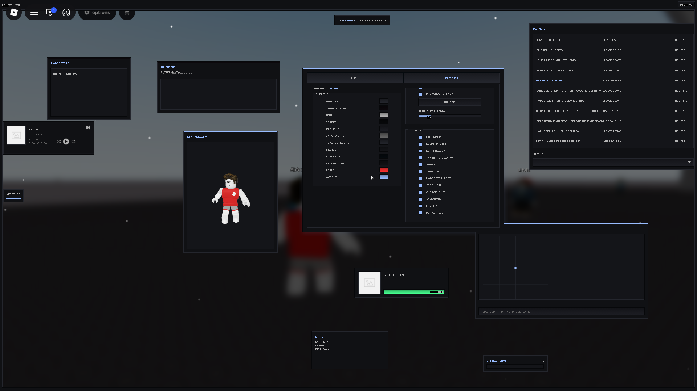

# 🖤 Landryhaxx UI — NH UI Library



> Чистая, многофункциональная Roblox exploit UI-библиотека на основе **NH UI**.  
> Поддерживает переключатели, слайдеры, дропдауны, горячие клавиши, пикеры цвета, текстовые поля, кнопки и множество встроенных виджетов.

---

## 📦 Установка

```lua
local Library = loadstring(game:HttpGet("https://raw.githubusercontent.com/Be1for/lua/refs/heads/main/Nhack%20Ui/Nhack_Ui.lua"))()
```

---

## 🚀 Быстрый старт

```lua
local Library = loadstring(game:HttpGet("https://raw.githubusercontent.com/Be1for/lua/refs/heads/main/Nhack%20Ui/Nhack_Ui.lua"))()

_G.Library = Library
getgenv().Library = Library

local Window = Library:Window({
    Title      = "Landryhaxx",
    ButtonName = "Main UI"
})

local Page    = Window:Page({ Name = "Main" })
local SubPage = Page:SubPage({ Name = "Combat" })
local Section = SubPage:Section({ Name = "Aimbot", Side = 1 })

Window:CreateSettingsPage()
```

---

## 🪟 Window (Окно)

Создаёт главное окно интерфейса.

```lua
local Window = Library:Window({
    Title      = "Landryhaxx",  -- Заголовок окна
    ButtonName = "Main UI"      -- Название кнопки открытия/закрытия
})
```

| Параметр     | Тип    | Описание                              |
|--------------|--------|---------------------------------------|
| `Title`      | string | Текст заголовка в верхней части окна  |
| `ButtonName` | string | Надпись на кнопке переключения UI     |

---

## 📄 Страницы и подстраницы

```lua
local Page    = Window:Page({ Name = "Main" })
local SubPage = Page:SubPage({ Name = "Combat" })
```

- **Page** — главная вкладка в окне.
- **SubPage** — вложенная вкладка внутри Page.

---

## 📋 Секции

Секции группируют элементы визуально. `Side` управляет колонкой: левая (`1`) или правая (`2`).

```lua
local LeftSection  = SubPage:Section({ Name = "Aimbot",  Side = 1 })
local RightSection = SubPage:Section({ Name = "Visuals", Side = 2 })
```

---

## 🔘 Toggle (Переключатель)

Простой переключатель вкл/выкл.

```lua
Section:Toggle({
    Name     = "Включить Аимбот",
    Flag     = "AimbotEnabled",   -- Уникальный ключ (используется для сохранения конфигов)
    Default  = false,             -- Начальное состояние (true = вкл, false = выкл)
    Callback = function(Value)
        -- Value = true или false
        print("Аимбот:", Value)
    end
})
```

| Параметр   | Тип      | Описание                              |
|------------|----------|---------------------------------------|
| `Name`     | string   | Текст рядом с переключателем          |
| `Flag`     | string   | Уникальный ключ для сохранения        |
| `Default`  | boolean  | Начальное состояние                   |
| `Callback` | function | Вызывается с `true` или `false`       |

---

## 🎚️ Slider (Слайдер)

Перетаскиваемый слайдер для числовых значений.

```lua
Section:Slider({
    Name     = "FOV",
    Flag     = "AimbotFOV",
    Default  = 90,       -- Начальное значение
    Min      = 1,        -- Минимальное значение
    Max      = 360,      -- Максимальное значение
    Decimals = 0,        -- Знаков после запятой (0 = целое число)
    Suffix   = "°",      -- Единица измерения после значения (необязательно)
    Callback = function(Value)
        print("FOV:", Value)
    end
})
```

| Параметр   | Тип      | Описание                                     |
|------------|----------|----------------------------------------------|
| `Name`     | string   | Подпись над слайдером                        |
| `Flag`     | string   | Уникальный ключ для сохранения               |
| `Default`  | number   | Начальное значение                           |
| `Min`      | number   | Минимально допустимое значение               |
| `Max`      | number   | Максимально допустимое значение              |
| `Decimals` | number   | Точность (`0` = целые числа)                 |
| `Suffix`   | string   | Текст-единица после значения (необязательно) |
| `Callback` | function | Вызывается с новым числовым значением        |

---

## 🔽 Dropdown (Выпадающий список)

Список выбираемых опций.

```lua
Section:Dropdown({
    Name     = "Часть тела",
    Flag     = "AimPart",
    Items    = { "Head", "Torso", "HumanoidRootPart" },
    Default  = "Head",   -- или таблица при Multi = true
    Multi    = false,    -- true = можно выбрать несколько
    Callback = function(Value)
        print("Выбрано:", Value)
    end
})
```

| Параметр   | Тип           | Описание                                        |
|------------|---------------|-------------------------------------------------|
| `Name`     | string        | Подпись над дропдауном                          |
| `Flag`     | string        | Уникальный ключ для сохранения                  |
| `Items`    | table         | Список строковых вариантов                      |
| `Default`  | string/table  | Выбранное значение по умолчанию                 |
| `Multi`    | boolean       | Разрешить выбор нескольких элементов            |
| `Callback` | function      | Вызывается с выбранным значением или таблицей   |

---

## 🔑 Keybind (Горячая клавиша)

Позволяет пользователю назначить клавишу.

```lua
Section:Label({ Name = "Клавиша переключения" }):Keybind({
    Flag     = "AimbotKey",
    Mode     = "Toggle",          -- "Toggle" (переключение) или "Hold" (удержание)
    Default  = Enum.KeyCode.E,
    Callback = function(Value)
        print("Клавиша изменена на:", Value)
    end
})
```

| Параметр   | Тип      | Описание                                 |
|------------|----------|------------------------------------------|
| `Flag`     | string   | Уникальный ключ для сохранения           |
| `Mode`     | string   | `"Toggle"` — переключение, `"Hold"` — удержание |
| `Default`  | KeyCode  | Клавиша по умолчанию                     |
| `Callback` | function | Вызывается при смене клавиши             |

---

## 🎨 Colorpicker (Выбор цвета)

Полноценный RGB/HSV пикер цвета.

```lua
Section:Label({ Name = "Цвет ESP" }):Colorpicker({
    Flag     = "ESPColor",
    Default  = Color3.fromRGB(255, 0, 0),
    Callback = function(Value)
        -- Value — это Color3
        print("Цвет:", Value)
    end
})
```

| Параметр   | Тип      | Описание                              |
|------------|----------|---------------------------------------|
| `Flag`     | string   | Уникальный ключ для сохранения        |
| `Default`  | Color3   | Цвет по умолчанию                     |
| `Callback` | function | Вызывается с новым значением `Color3` |

---

## ✏️ Textbox (Текстовое поле)

Поле для ввода текста.

```lua
Section:Textbox({
    Name        = "Название конфига",
    Flag        = "ConfigName",
    Placeholder = "Введите название...",
    Callback    = function(Value)
        print("Введено:", Value)
    end
})
```

| Параметр      | Тип      | Описание                                  |
|---------------|----------|-------------------------------------------|
| `Name`        | string   | Подпись над полем                         |
| `Flag`        | string   | Уникальный ключ                           |
| `Placeholder` | string   | Серый текст-подсказка когда поле пустое   |
| `Callback`    | function | Вызывается со строковым значением         |

---

## 🖱️ Button (Кнопка)

Кликабельная кнопка.

```lua
Section:Button({
    Name     = "Выполнить",
    Callback = function()
        print("Кнопка нажата!")
    end
})
```

| Параметр   | Тип      | Описание                 |
|------------|----------|--------------------------|
| `Name`     | string   | Текст на кнопке          |
| `Callback` | function | Вызывается при нажатии   |

---

## 🏷️ Label (Метка)

Статичный текстовый элемент. Также служит родителем для Keybind и Colorpicker.

```lua
Section:Label({ Name = "Заголовок секции" })
```

---

## 🔔 Notification (Уведомление)

Показывает временное всплывающее уведомление.

```lua
Library:Notification(
    "Landryhaxx загружен",     -- Текст сообщения
    3,                          -- Длительность в секундах
    Library.Theme["Accent"]    -- Цвет акцента (Color3)
)
```

---

## 🌊 Watermark (Водяной знак)

Перетаскиваемый оверлей с динамической информацией (FPS, время и т.д.).

```lua
local Watermark = Library:Watermark({ Name = "Landryhaxx" })

Watermark:SetDynamicTextProvider(function(Fps)
    return string.format("Landryhaxx | %dfps | %s", Fps, os.date("%X"))
end)

Watermark:SetVisibility(true)   -- показать
Watermark:SetVisibility(false)  -- скрыть
```

---

## ⌨️ Keybind List (Список клавиш)

Отображает все активные горячие клавиши в плавающей панели.

```lua
local KeybindList = Library:KeybindList({ Name = "Keybinds" })
KeybindList:SetVisibility(true)
```

---

## 👁️ ESP Preview (Превью ESP)

Плавающий предпросмотр настроек ESP.

```lua
local ESPPreview = Library:ESPPreview({ Name = "ESP Preview" })
ESPPreview:SetVisibility(false)
```

---

## 🎯 Target Indicator (Индикатор цели)

Показывает направление к текущей цели.

```lua
local TargetIndicator = Library:TargetIndicator()
TargetIndicator:SetVisibility(false)
```

---

## 📡 Radar (Радар)

Мини-карта с отображением ближайших игроков.

```lua
local Radar = Library:RadarWidget({ Name = "Radar" })
Radar:SetVisibility(false)
```

---

## 🖥️ Console Logger (Консоль)

Плавающая консоль для вывода отладочной информации.

```lua
local Logger = Library:ConsoleLogger({
    Name     = "Console",
    Callback = function(Text, Log)
        Log:AddOutput(Text)
    end
})
Logger:SetVisibility(false)
```

---

## 🛡️ Moderator List (Список модераторов)

Отображает список модераторов в игре.

```lua
local ModeratorList = Library:ModeratorList({ Name = "Moderators" })
ModeratorList:SetVisibility(false)
```

---

## 📊 Stat List (Список статистики)

Показывает пользовательские строки статистики (убийства, смерти, KDR и т.д.).

```lua
local StatList = Library:StatListWidget({ Name = "Stats" })

StatList:SetLines({
    "Убийств: 0",
    "Смертей: 0",
    "KDR: 0.00"
})
StatList:SetVisibility(false)
```

---

## ⚡ Charge Shot (Заряженный выстрел)

Визуальный индикатор механики заряженного выстрела.

```lua
local ChargeShot = Library:ChargeShotWidget({ Name = "Charge Shot" })
ChargeShot:SetVisibility(false)
```

---

## 🎒 Inventory Viewer (Инвентарь)

Отображает предметы инвентаря локального игрока.

```lua
local Inventory = Library:InventoryViewer({ Name = "Inventory" })
Inventory:SetVisibility(false)
```

---

## 🎵 Spotify Player (Музыкальный плеер)

Плавающий виджет в стиле Spotify.

```lua
local Spotify = Library:SpotifyPlayer()
Spotify:SetVisibility(false)
```

---

## 👥 Player List (Список игроков)

Показывает всех игроков на сервере.

```lua
local Playerlist = Library:Playerlist({ Name = "Players" })
Playerlist:SetVisibility(false)
```

---

## ⚙️ Регистрация виджетов в настройках

Добавляет любой виджет как переключатель на встроенной странице настроек.

```lua
Library:RegisterSettingsWidget({
    Name     = "Watermark",
    Default  = true,            -- Виден по умолчанию?
    Callback = function(Value)
        Watermark:SetVisibility(Value)
    end
})
```

---

## 💾 Система конфигов

Встроена в страницу настроек через `Window:CreateSettingsPage()`.

```lua
Window:CreateSettingsPage()
```

Добавляет:
- **Configs** — создать, загрузить, сохранить, удалить JSON-конфиги
- **Theming** — живая настройка цветов всех элементов UI
- **Settings** — горячая клавиша UI, размытие/снег фона, скорость анимации, кнопка выгрузки
- **Widgets** — переключение видимости всех зарегистрированных виджетов

---

## 🎨 Тема оформления

Доступ к цветам темы через `Library.Theme`:

```lua
Library.Theme["Accent"]      -- Основной акцентный цвет
Library.Theme["Background"]  -- Цвет фона
```

Изменить цвет темы в реальном времени:

```lua
Library:ChangeTheme("Accent", Color3.fromRGB(100, 200, 255))
```

---

## 🗑️ Выгрузка

Полностью уничтожает UI и все соединения:

```lua
Library:Exit()
```

---

## 📝 Полный пример скрипта

```lua
local Library = loadstring(game:HttpGet("https://raw.githubusercontent.com/Be1for/lua/refs/heads/main/Nhack%20Ui/Nhack_Ui.lua"))()

_G.Library = Library
getgenv().Library = Library

local Watermark = Library:Watermark({ Name = "Landryhaxx" })
Watermark:SetDynamicTextProvider(function(Fps)
    return string.format("Landryhaxx | %dfps | %s", Fps, os.date("%X"))
end)

local KeybindList = Library:KeybindList({ Name = "Keybinds" })

local Window = Library:Window({
    Title      = "Landryhaxx",
    ButtonName = "Main UI"
})

Library:RegisterSettingsWidget({
    Name = "Watermark", Default = true,
    Callback = function(v) Watermark:SetVisibility(v) end
})
Library:RegisterSettingsWidget({
    Name = "Keybind List", Default = true,
    Callback = function(v) KeybindList:SetVisibility(v) end
})

local Page    = Window:Page({ Name = "Main" })
local SubPage = Page:SubPage({ Name = "Combat" })

local Left  = SubPage:Section({ Name = "Aimbot",  Side = 1 })
local Right = SubPage:Section({ Name = "Visuals", Side = 2 })

Left:Toggle({
    Name = "Включить Аимбот", Flag = "AimbotEnabled", Default = false,
    Callback = function(Value) end
})

Left:Slider({
    Name = "FOV", Flag = "AimbotFOV",
    Default = 90, Min = 1, Max = 360, Decimals = 0,
    Callback = function(Value) end
})

Right:Toggle({
    Name = "ESP", Flag = "ESPEnabled", Default = false,
    Callback = function(Value) end
})

Library:Notification("Landryhaxx загружен", 3, Library.Theme["Accent"])

Window:CreateSettingsPage()
```

---

## 📄 Лицензия

Этот проект создан **исключительно в образовательных целях**.  
Используйте ответственно и в соответствии с правилами платформы.
