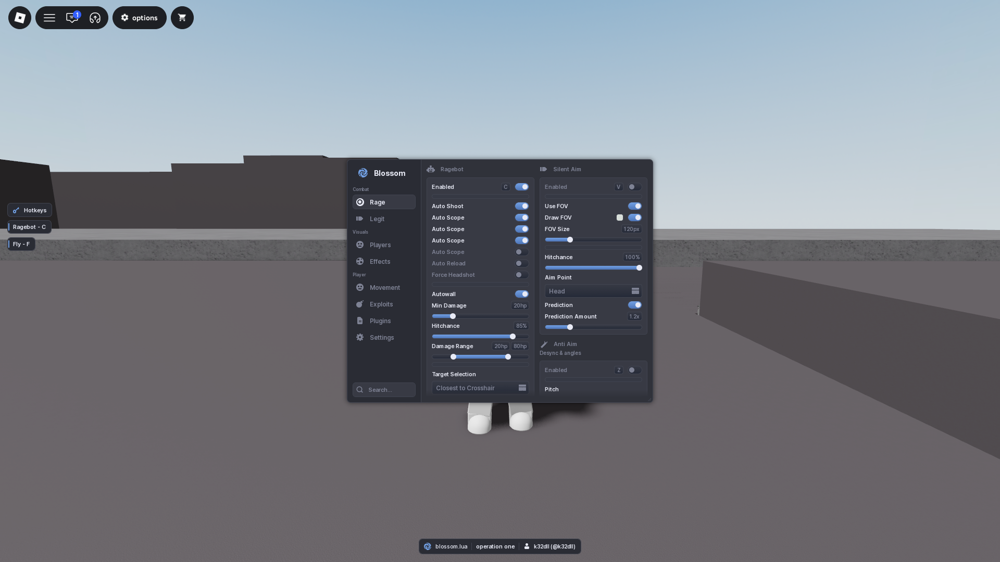

# Blossom UI


## Содержание

- [Установка](#установка)
- [Создание окна](#создание-окна)
- [Категории и вкладки](#категории-и-вкладки)
- [Секции](#секции)
- [Toggle](#toggle)
- [Slider](#slider)
- [RangeSlider](#rangeslider)
- [Dropdown](#dropdown)
- [Colorpicker](#colorpicker)
- [Keybind](#keybind)
- [Button](#button)
- [Textbox](#textbox)
- [Label](#label)
- [Divider](#divider)
- [Listbox](#listbox)
- [Уведомления](#уведомления)
- [Встроенная вкладка настроек](#встроенная-вкладка-настроек)

## Установка

```lua
local Blossom;
if script and script.Parent and script.Parent:FindFirstChild("Blossom") then
    Blossom = require(script.Parent.Blossom);
else
    Blossom = loadstring(game:HttpGet("https://raw.githubusercontent.com/mmr1337/Blossom/refs/heads/main/Blossom.luau"))();
end
```

## Создание окна

```lua
local Window = Blossom.new({
    Title = "Blossom",
    Script = "blossom.lua",
    Build = "operation one",
    Theme = "Blossom",
    MenuKey = Enum.KeyCode.RightShift,
});
```

Параметры:

| Параметр | Тип | Описание |
|---|---|---|
| `Title` | string | Заголовок окна в сайдбаре |
| `Script` | string | Текст первого блока в watermark |
| `Build` | string | Текст второго блока в watermark |
| `Theme` | string | Название темы из списка ниже |
| `Font` | string | Название шрифта |
| `Size` / `MinSize` | Vector2 | Стартовый и минимальный размер окна |
| `MenuKey` | Enum.KeyCode | Клавиша скрытия/показа окна |
| `Resizable` | bool | Можно ли менять размер окна (по умолчанию `true`) |

Доступные темы: `Blossom`, `Afterglow`, `Frostbite`, `Volt`, `Obsidian`, `Sakura Drift`, `Neon Mirage`, `Copper Dust`, `Abyss`, `Porcelain`, `Graphite`.

## Категории и вкладки

`Category` рисует заголовок-разделитель в сайдбаре, `Tab` создаёт вкладку с иконкой.

```lua
Window:Category("Combat");
local Rage = Window:Tab({ Name = "Rage", Icon = "target" });
```

Доступные иконки: `target`, `bullet`, `smile`, `globe`, `bomb`, `file`, `gear`, `robot`, `wrench`, `cube`, `search`, `user`, `key`, `grip`, `check`, `layout`, `reset`, `logo`.

## Секции

Секция — карточка с заголовком внутри вкладки. `Side` определяет колонку: `1` — левая, `2` — правая.

```lua
local Ragebot = Rage:Section({ Name = "Ragebot", Icon = "robot", Side = 1 });
```

Можно добавить подпись под заголовком через `Description`:

```lua
local AntiAim = Rage:Section({ Name = "Anti Aim", Icon = "wrench", Description = "Desync & angles", Side = 2 });
```

Секции внутри одной колонки можно перетаскивать мышкой за заголовок, меняя порядок.

---

## Toggle

Переключатель вкл/выкл. Поддерживает встроенный Keybind и Colorpicker прямо в строке.

```lua
local Enabled = Ragebot:Toggle({
    Name = "Enabled",
    Default = true,
    Keybind = Enum.KeyCode.C,
    Callback = function(value)
        print("Ragebot enabled:", value);
    end
});
```

| Параметр | Описание |
|---|---|
| `Name` | Название элемента |
| `Default` | Начальное значение (`true`/`false`) |
| `Keybind` | Клавиша для быстрого переключения |
| `KeybindMode` | `"Toggle"` или `"Hold"` |
| `Color` | Добавляет цветовой свотч рядом (Colorpicker) |
| `Callback` | Функция, вызываемая при изменении |
| `Flag` | Кастомный ключ для сохранения в конфиг |
| `NoSave` | Исключить из сохранения конфига |

Изменить значение из кода:

```lua
Enabled:Set(false);
```

## Slider

Ползунок с числовым значением. Значение можно менять мышкой или кликом по числу (вводом с клавиатуры).

```lua
local MinDamage = Ragebot:Slider({
    Name = "Min Damage",
    Min = 1,
    Max = 100,
    Default = 20,
    Suffix = "hp",
    Callback = function(value)
        print("Min Damage:", value);
    end
});
```

| Параметр | Описание |
|---|---|
| `Min` / `Max` | Границы значения |
| `Default` | Начальное значение |
| `Decimals` | Количество знаков после запятой |
| `Suffix` | Текст после числа (`"%"`, `"px"`, `"hp"` и т.д.) |
| `Callback` | Функция при изменении значения |

```lua
MinDamage:Set(55);
```

## RangeSlider

Ползунок с двумя бегунками — минимальным и максимальным значением одновременно.

```lua
local DamageRange = Ragebot:RangeSlider({
    Name = "Damage Range",
    Min = 0,
    Max = 100,
    Default = { 20, 80 },
    Suffix = "hp",
    Callback = function(value)
        print(value[1], value[2]);
    end
});
```

```lua
DamageRange:Set({ 10, 90 });
```

## Dropdown

Выпадающий список. Поддерживает одиночный и множественный выбор (`Multi = true`).

```lua
local Target = Ragebot:Dropdown({
    Name = "Target Selection",
    Options = { "Closest to Crosshair", "Lowest Health", "Highest Threat", "Closest Distance" },
    Default = "Closest to Crosshair",
    Callback = function(value)
        print("Selected:", value);
    end
});
```

Множественный выбор:

```lua
local Hitboxes = Targeting:Dropdown({
    Name = "Hitboxes",
    Options = { "Head", "Torso", "Arms", "Legs" },
    Default = { "Head", "Torso" },
    Multi = true,
    Callback = function(value)
        for option, enabled in value do
            print(option, enabled);
        end
    end
});
```

| Параметр | Описание |
|---|---|
| `Options` | Список вариантов |
| `Default` | Значение по умолчанию (таблица значений при `Multi`) |
| `Multi` | Множественный выбор |
| `MaxRows` | Сколько строк показывать без прокрутки (по умолчанию 10) |
| `Empty` | Текст, если список вариантов пуст |

Обновить список вариантов на лету:

```lua
Target:SetOptions({ "Lowest Health", "Closest Distance" });
```

## Colorpicker

Отдельный элемент выбора цвета со встроенной палитрой, HSV-кругом и прозрачностью.

```lua
local ESPColor = PlayerESP:Colorpicker({
    Name = "Box Color",
    Default = Color3.fromRGB(255, 255, 255),
    Callback = function(color, alpha)
        print(color, alpha);
    end
});
```

```lua
ESPColor:Set(Color3.fromRGB(255, 0, 0), 0.2);
```

> Colorpicker также можно добавить встроенным в Toggle или Label через параметр `Color = Color3.fromRGB(...)`.

## Keybind

Отдельная строка для назначения клавиши. ПКМ по чипу открывает меню Toggle/Hold.

```lua
local MenuKeybind = Rage:Keybind({
    Name = "Panic Key",
    Default = Enum.KeyCode.F1,
    Mode = "Toggle",
    Callback = function()
        print("Panic key pressed");
    end
});
```

```lua
MenuKeybind:Set(Enum.KeyCode.Q);
```

## Button

Обычная кнопка с текстом по центру.

```lua
Ragebot:Button({
    Name = "Reset Settings",
    Callback = function()
        print("Settings were reset");
    end
});
```

## Textbox

Поле для ввода текста.

```lua
local NameBox = Window:Tab({ Name = "Example" }):Section({ Name = "Input" }):Textbox({
    Name = "Config name",
    Placeholder = "Enter name...",
    Default = "",
    Callback = function(text)
        print("Text:", text);
    end
});
```

```lua
NameBox:Set("MyConfig");
```

## Label

Простая текстовая строка. Может содержать встроенный Keybind или Color, как и Toggle.

```lua
Plugins:Section({ Name = "Plugins", Icon = "file", Side = 1 }):Label({ Name = "No plugins loaded" });
```

```lua
local Status = SomeSection:Label({ Name = "Status: idle" });
Status:Set("Status: running");
```

## Divider

Горизонтальная разделительная линия между блоками элементов внутри секции.

```lua
Ragebot:Divider();
```

## Listbox

Прокручиваемый список строк с выделением (используется, например, для списка конфигов).

```lua
local Configs = Window:Tab({ Name = "Example" }):Section({ Name = "Profiles" }):Listbox({
    Height = 177,
    Options = { "Default", "Legit", "Rage" },
    Empty = "No configs yet",
    Callback = function(value)
        print("Selected config:", value);
    end
});
```

```lua
Configs:SetOptions({ "Default", "New Config" });
Configs:Set("New Config");
```

## Уведомления

Всплывающие уведомления в левом верхнем углу экрана.

```lua
Window:Notify({
    Text = "Settings saved successfully.",
    Icon = "check",
    Duration = 3
});
```

Короткая форма:

```lua
Window:Notify("Done!");
```

## Встроенная вкладка настроек

Библиотека умеет сама строить вкладку с профилями конфигов, автозагрузкой, выбором темы и шрифта — достаточно передать пустую вкладку:

```lua
local Settings = Window:Tab({ Name = "Settings", Icon = "gear" });
Window:BuildSettings(Settings);
```

Эта вкладка автоматически добавляет:

- Создание / загрузку / перезапись / удаление конфигов
- Автозагрузку выбранного конфига при старте
- Выбор темы оформления и регистра текста (casing)
- Настройку всех 11 цветов темы вручную
- Клавишу открытия/скрытия меню
- Переключение watermark и списка хоткеев
- Выбор шрифта и его насыщенности

---

## Полезные методы окна

```lua
Window:Toggle();                 -- показать/скрыть окно
Window:SetVisible(true);         -- показать окно явно
Window:SetSize(640, 480);        -- изменить размер окна из кода
Window:ApplyTheme("Obsidian");   -- сменить тему из кода
Window:SaveConfig("MyConfig");   -- сохранить текущий конфиг
Window:LoadConfig("MyConfig");   -- загрузить конфиг
Window:Destroy();                -- полностью удалить интерфейс
```
